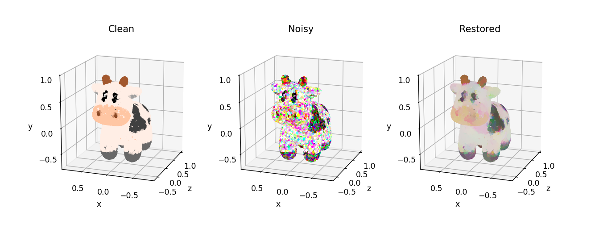

# Chambolle-Pock for 3D Point Cloud Denoising

Extends the Chambolle-Pock method for 2D image denoising to 3D point clouds inspired from the work of Tenbrinck, Lozes, and Elmoataz (SSVM 2015). The implementation is demonstrated on the Spot dataset ([https://www.cs.cmu.edu/~kmcrane/Projects/ModelRepository/](https://www.cs.cmu.edu/~kmcrane/Projects/ModelRepository/)).

Example of point cloud denoising on Spot (Keenan Crane, CMU):


## Layout

The relevant files can be found as follows:

1. `src/cp_pointcloud/denoise.py`: The implementation of the Chambolle-Pock algorithm for point cloud denoising.
2. `src/experiments/exp_color/color.py`: The implementation of the experiment.
3. `src/experiments/exp_color/run_exp_color.py`: The entry point of the experiment.
4. `src/experiments/exp_color/spot.zip`: The dataset for the experiment.
5. `notebooks/chambolle_pock_color_denoising.ipynb`: The notebook demonstrating the denoising process and the effects of the parameters on this experiment.


## Usage

```bash
git clone https://github.com/aadarsh-ram/chambolle-pock-point-cloud-denoising.git
cd chambolle-pock-point-cloud-denoising
pip install -r requirements.txt
pip install -e .
```


## References

Chambolle and Pock, [A first-order primal-dual algorithm for convex problems with applications to imaging](https://hal.science/hal-00490826), 2011. Algorithm 1.

Tenbrinck, Lozes, and Elmoataz, [Solving minimal surface problems on surfaces and point clouds](https://elmoatazbill.users.greyc.fr/point_cloud/2015_tenbrinck_ssvm.pdf), SSVM 2015. Equations (7), (14), and (20). We only consider the isotropic graph for denoising.