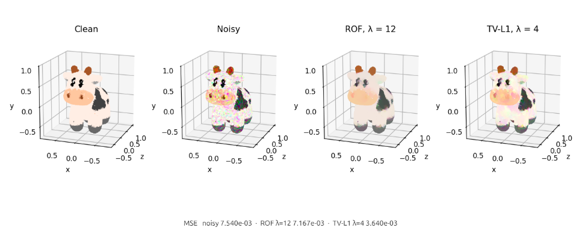
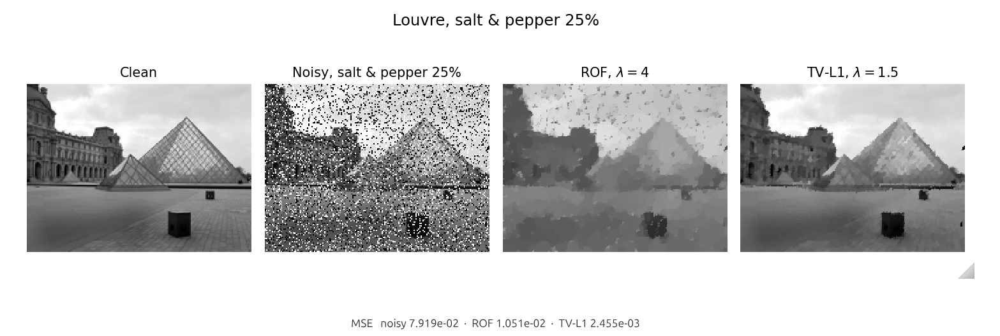

# Chambolle-Pock for 3D Point Cloud Denoising

Extends the Chambolle-Pock method for 2D image denoising to color denoising in 3D point clouds inspired from [2]. We demonstrate the application on Keenan Crane's Spot, a 3D model of a cow [3] using both the ROF and TV-L1 model.

Example of point cloud denoising (gaussian noise) on Spot:


We also reproduce the 2D image denoising result of [1] (Figure 4(a)).


## Repository Structure
```
├── assets/
├── docs/ - All references, documentation and our presentation can be found here.
├── experiments/
├── models/
├── notebooks/ - 'chambolle_pock_2D_denoising.ipynb' demonstrates the denoising process and the effects of the parameters on the 2D denoising experiment. 'chambolle_pock_color_denoising.ipynb' demonstrates the denoising process and the effects of the parameters on the color denoising experiment.
├── src/ - All the source code for the methods. 'cp_solver' contains the Chambolle-Pock algorithm and the proximal maps. 'cp_image' and 'cp_pointcloud' contain the implementations of the 2D and 3D denoising experiments respectively.
├── scripts/ - 'denoise_cloud.py' runs the non-interactive denoising experiment.
├── tests/
├── .gitignore
├── README.md
└── requirements.txt
```

## Usage

```bash
git clone https://github.com/aadarsh-ram/chambolle-pock-point-cloud-denoising.git
cd chambolle-pock-point-cloud-denoising
pip install -r requirements.txt
pip install -e .
pytest
```

## References

[1] Chambolle and Pock, [A first-order primal-dual algorithm for convex problems with applications to imaging](https://hal.science/hal-00490826), 2011. Algorithm 1, and the TV-L1 image denoising model.

[2] Tenbrinck, Lozes, and Elmoataz, [Solving minimal surface problems on surfaces and point clouds](https://elmoatazbill.users.greyc.fr/point_cloud/2015_tenbrinck_ssvm.pdf), SSVM 2015. Equations (7), (14), and (20). We only borrow the idea of representing the point cloud as an isotropic graph. The TV formulation and denoising are not exactly the same as in the paper.

[3] Keenan Crane, [Spot: A 3D Model of a Cow](https://www.cs.cmu.edu/~kmcrane/Projects/ModelRepository/), 2015. The Spot dataset is a 3D model of a cow.

## Acknowledgments
This work is part of the course project for course EE5121: Convex Optimization taught by Prof. Pravin Nair (Fall 2026) at IIT Madras. Thanks to my teammates Kartik Patil and Aravind Chandramoulli for their contributions.