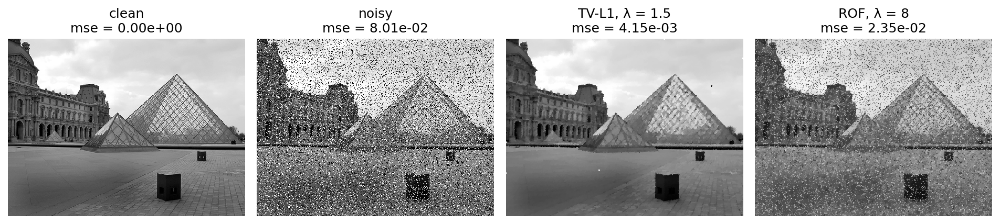
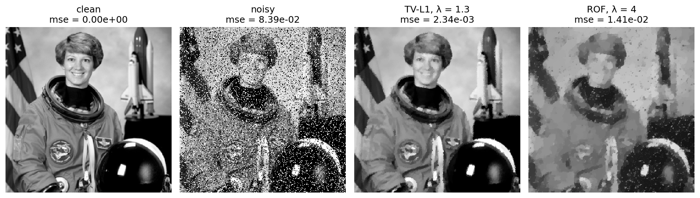

# exp_tvl1

Remove salt-and-pepper noise from a grayscale image with the TV-L1 model, and compare with the ROF model.

## Setup

This follows the TV-L1 image denoising application of Chambolle and Pock (2011):

\[
\min_u \; \|\nabla u\|_{2,1} + \lambda \|u - f\|_1 .
\]

The image is a graph with one edge from each pixel to its right neighbor and one to the pixel below. On that graph the vertex norm of Tenbrinck et al. (7) is the paper's discrete isotropic total variation with forward differences and a Neumann boundary, and \(\|K\|^2 \le 8\). The solver is the same `chambolle_pock` used for point clouds, with `data="l1"`. The primal prox becomes a soft-threshold toward the noisy image.

By default the clean image is a synthetic 128 x 128 piecewise-constant image (a square, a disk, and a thin bar). `--image` uses any grayscale-convertible file instead, shrunk so its longer side is `--size` pixels. The paper's own test image, the 500 x 375 grayscale photo of the Louvre pyramid from its Figure 4(a), is in `models/experiments/exp_tvl1/louvre.png`. A second natural image, the public-domain NASA portrait of the astronaut Eileen Collins that scikit-image ships, is in `models/experiments/exp_tvl1/astronaut.png`. It is stored in color and read as grayscale.

A fraction of 0.25 of the pixels is replaced by 0 or 1 with equal chance. The noisy image is then denoised twice:

- TV-L1 with \(\lambda = 1\)
- ROF with \(\lambda = 3\), the best of \(\{1, 2, 3, 4, 6, 8\}\) on the default image

## Usage

```bash
PYTHONPATH=src python -m experiments.exp_tvl1.run_exp_tvl1
```

The comparison is saved to `results/experiments/exp_tvl1/exp_tvl1_comparison.png` and the errors to `exp_tvl1_metrics.txt` next to it. `--no-show` saves the figure without opening a window.

To repeat Figure 4 of the paper on the Louvre image, with the paper's \(\lambda\) values:

```bash
PYTHONPATH=src python -m experiments.exp_tvl1.run_exp_tvl1 \
    --image models/experiments/exp_tvl1/louvre.png --size 500 \
    --lam-l1 1.5 --lam-l2 8 \
    --output results/experiments/exp_tvl1/louvre/exp_tvl1_comparison.png --no-show
```

On the astronaut image, shrunk to 256 x 256:

```bash
PYTHONPATH=src python -m experiments.exp_tvl1.run_exp_tvl1 \
    --image models/experiments/exp_tvl1/astronaut.png --size 256 \
    --lam-l1 1.3 --lam-l2 4 \
    --output results/experiments/exp_tvl1/astronaut/exp_tvl1_comparison.png --no-show
```

## Result

On the default synthetic image:

| | mse |
|---|---|
| noisy | 8.00e-02 |
| TV-L1, \(\lambda = 1\) | 5.0e-04 |
| ROF, \(\lambda = 3\) | 8.8e-03 |

TV-L1 removes the impulses and keeps the edges and the contrast of each shape. A pixel whose value is far from its neighbors costs TV-L1 a fixed amount to remove, whatever its height, so it is removed outright. ROF pays quadratically for large residuals, so it spreads each impulse into its neighborhood instead.

On the Louvre image from Figure 4 of the paper (375 x 500, 25% salt and pepper, seed 0):

| | mse |
|---|---|
| noisy | 8.01e-02 |
| TV-L1, \(\lambda = 1.5\) | 4.2e-03 |
| ROF, \(\lambda = 8\) | 2.4e-02 |



TV-L1 removes almost all of the noise and keeps the glass grid of the pyramid and the small blocks in the foreground, as in Figure 4(d) of the paper. At \(\lambda = 8\), our ROF result still shows many impulses. The paper's Figure 4(c) is much smoother at the same \(\lambda\), so the paper's ROF data weight is probably scaled differently from our `data="l2"` term.

On the astronaut image (256 x 256, 25% salt and pepper, seed 0):

| | mse |
|---|---|
| noisy | 8.39e-02 |
| TV-L1, \(\lambda = 1.3\) | 2.3e-03 |
| ROF, \(\lambda = 4\) | 1.4e-02 |



TV-L1 keeps the face, the flag stripes, and the shuttle. ROF flattens them into patches and leaves dark impulses on the bright helmet and background.

The threshold is exact for a single pixel on a flat image: it is removed when \(\lambda < 2 + \sqrt{2}\) and kept when \(\lambda > 2 + \sqrt{2}\). `tests/test_tvl1_denoise.py` checks both sides.

## Layout

1. `src/cp_pointcloud/tvl1_denoise.py`: the pixel grid, `denoise_image`, and the TV-L1 energy.
2. `src/cp_pointcloud/denoise.py`: the Chambolle-Pock iteration, with the `data` option.
3. `experiments/exp_tvl1/image.py`: the synthetic image, salt-and-pepper noise, and the error.
4. `experiments/exp_tvl1/figure.py`: the comparison figure.
5. `experiments/exp_tvl1/run_exp_tvl1.py`: the entry point of the experiment.
6. `models/experiments/exp_tvl1/louvre.png`: the clean test image of Figure 4 of the paper.
7. `models/experiments/exp_tvl1/astronaut.png`: the astronaut test image from scikit-image.
